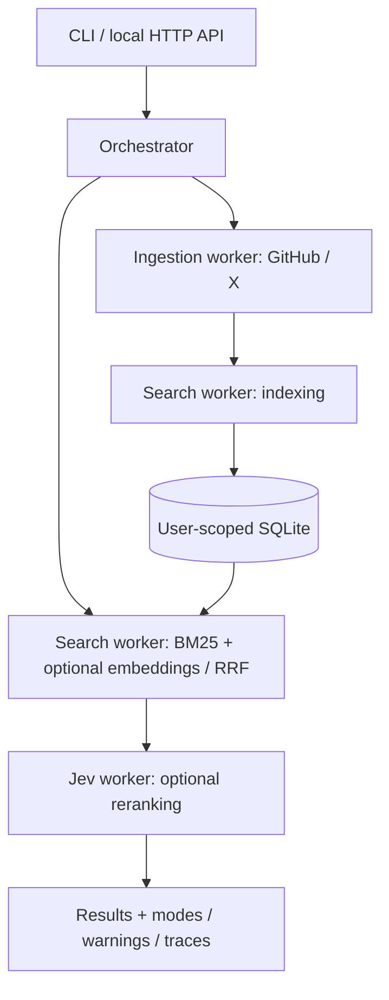

# Bookmark Finder

Search your GitHub stars and X bookmarks from a local CLI or HTTP API. Bookmark Finder imports saved items into SQLite, retrieves candidates with BM25 and optional embedding search, then optionally reranks them with Jev.

This is a **local backend MVP**. It has no web frontend, OAuth connection or token-refresh UI, scheduled sync, or authenticated multiuser server. Live provider access, multilingual search quality, latency, and cost have not yet been validated. See [STATUS.md](STATUS.md) for the current stage.

## Quick start

Requires **Node.js 24 or newer**. The backend uses ES modules and Node built-ins only; no npm packages, Docker, or separate database server are required. Python 3 is used for setup and source packaging only.

Run these commands from the repository root:

```sh
npm run setup
npm run demo
npm run search -- "React analytics" --demo
npm run serve:demo
```

Setup creates a local `.env` from `.env.example` if absent and prepares `.venv`. It preserves an existing `.env`. The Python environment is only for the packaging helper; you do not need to activate it to run the Node backend.

Demo mode uses five labeled sample entries, **lexical search only**, and no external API calls. It does not demonstrate embedding or Jev model quality. `npm run demo` uses an in-memory database; `npm run serve:demo` uses the separate `data/demo.sqlite` file.

With the demo server running, search from another terminal:

```sh
curl http://127.0.0.1:4317/api/search \
  -H 'X-Recall-Client: local' \
  -H 'Content-Type: application/json' \
  -d '{"query":"PDF table extraction Python","limit":5}'
```

The API returns source links, excerpts, scores, modes, warnings, and worker timings. Without Jev, `relevanceScore` and `confidence` are `null`. Excerpts are source text, not generated match explanations. Stop the server with `Ctrl+C`.

## Search your own saved items

Run setup, then edit `.env` locally. Never put credentials in chat, source files, or Git. `.env`, `.venv`, and `data/` are excluded from Git and source packages.

| Variable | Purpose |
| --- | --- |
| `GITHUB_TOKEN` | Read access to the authenticated user's stars. For a fine-grained token, use the Starring user permission with read access; README access depends on repository permissions. |
| `X_ACCESS_TOKEN` | User-context OAuth token with `bookmark.read`, `tweet.read`, and `users.read`; the app also needs X API access. |
| `X_USER_ID` | Numeric account ID for the same X user. |
| `JEV_API_KEY` | Official TypeSafe API key for optional Jev reranking. |
| `JEV_MODEL` | Jev model ID; defaults to `jev-latest`. |
| `EMBEDDING_BASE_URL` | Optional embeddings-compatible provider base URL, including `/v1`. HTTPS is required except on loopback. |
| `EMBEDDING_MODEL` | Embedding model ID; required with the embedding base URL. |
| `EMBEDDING_API_KEY` | Embedding provider key; may be empty for a local server that needs no key. |
| `RECALL_DB` | Database path; defaults to `./data/recall.sqlite`. |
| `RECALL_PORT` | Local API port; defaults to `4317`. |

The `RECALL_*` environment variables and `X-Recall-Client` header retain their existing names for compatibility.

```sh
npm run sync -- github
npm run sync -- x
npm run index
npm run search -- "self-hosted analytics"
npm start
```

Sync only the providers you configure. Sync indexes imported entries; run `npm run index` after adding embedding settings to existing data. Unchanged content reuses cached embeddings. When changing providers or models, use a distinct model ID or clear the old embedding data.

Import is read-only. Incomplete or failed sync preserves earlier entries; a complete sync replaces that source's snapshot. Imports are bounded to 10 pages and 1,000 entries per source. GitHub README enrichment covers at most the newest 100 repositories, with a 64 KiB limit per README. Linked pages and post threads are not downloaded. See [connector behavior](docs/connectors.md).

Saved content stays in local SQLite, without application-level disk encryption. If enabled, the embedding provider receives indexed text and search queries; Jev receives each candidate's query, title, and up to 12,000 characters of content. Configure providers whose data handling suits your saved items.

## How it works



The orchestrator and three workers run in one Node process. The orchestrator routes jobs through explicit code contracts; it does not make an extra LLM call to plan each request.

- **Ingestion:** bounded pagination, README enrichment, and incomplete snapshot detection.
- **Search:** BM25, optional embedding cosine similarity, and reciprocal rank fusion (RRF). Retrieves up to 40 candidates with explicit lexical fallback when semantic search is unavailable.
- **Jev:** official TypeSafe Score API, bounded concurrency, and four relevance levels. Any candidate evaluation failure returns the whole result set to retrieval order with a warning.

Jev relevance is `score / 3`, not a probability of correctness. Confidence is separate and never used as relevance. Retrieval scores are ranking signals, not probabilities. Up to two searches run concurrently, with up to four parallel Jev requests per search.

Data and jobs are user-scoped. The HTTP API uses a fixed local principal and binds only to `127.0.0.1`; the local-client header is not multiuser authentication. Remote hosting requires authentication and authorization first. Interrupted persistent jobs are marked failed after restart and are not automatically retried.

Worker details: [connectors](docs/connectors.md), [search](docs/search.md), [Jev](docs/jev.md), and [contracts](docs/CONTRACTS.md).

## HTTP API

Private-data endpoints require `X-Recall-Client: local`. JSON POST requests also require `Content-Type: application/json`. Credentials and user identity come from local configuration, not request bodies.

| Endpoint | Request / result |
| --- | --- |
| `GET /api/health` | Liveness, without private data. |
| `GET /api/status` | Entry counts, configured workers, and recent jobs. |
| `POST /api/search` | `{"query":"...","source":"github","limit":10}`; source is optional. |
| `POST /api/sync` | `{"source":"github"}` or `{"source":"x"}`; returns a job ID with HTTP 202. |
| `POST /api/index` | `{}`; returns a job ID with HTTP 202. |
| `GET /api/jobs/:id` | Job state, traces, result, or sanitized error. |
| `POST /api/import` | `{"entries":[...]}` matching the entry contract. |
| `DELETE /api/entries?source=x` | Deletes local entries for that source; omit source to delete all local entries. Does not change provider bookmarks or stars. |

## Development and verification

```sh
npm test
npm run check
npm run demo
```

Tests exercise real loopback HTTP and SQLite, with injected mocks for GitHub, X, embeddings, and Jev. They verify behavior and integration, not live model quality. See [validation scope](docs/VALIDATION.md) and the [tests](test/).

Development roles and file ownership are documented in [AGENTS.md](AGENTS.md). New development subagents use `gpt-6.1-sol` with `high` reasoning effort; defaults and role definitions live in `.codex/`. These development settings are separate from runtime `JEV_MODEL` and the configured embedding model.

## Source package

The project keeps separate source files in one main folder: `src/`, `test/`, `fixtures/`, `scripts/`, and `docs/`.

```sh
npm run package
```

This runs `.venv/bin/python scripts/package.py` and creates `dist/bookmarkfinder.zip` with a `bookmarkfinder/` root folder. It includes source, example configuration, tests, and documentation. Local credentials, data, virtual environments, and earlier archives are excluded. After extracting, run `npm run setup` inside the extracted folder.

## License

[MIT](LICENSE) © 2026 ismailucrn.
