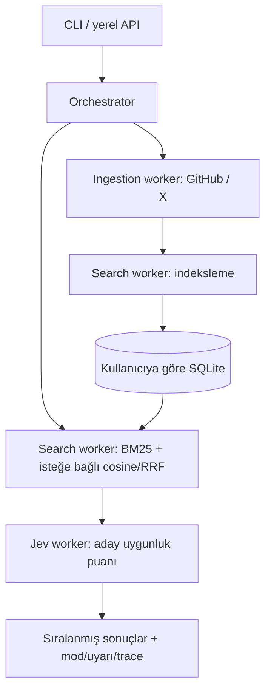

# Recall — kişisel kayıt arama sistemi

GitHub yıldızları ve X yer imleri üzerinde arama yapan, **bir orchestrator + üç worker** içeren yerel backend MVP. Geliştirme de aynı iş bölümüyle yapıldı: ingestion, search ve Jev workerları ayrı agentlar tarafından yazılıp çapraz incelendi; ana agent entegrasyon ve testleri yönetti.

**Güncel aşama ve sohbetler arası devir:** [STATUS.md](STATUS.md). Codex yerel projesinin kökü, bu README'nin bulunduğu ana proje klasörüdür.

**Çalışanlar:** SQLite kayıt, GitHub/X okuma entegrasyonları, BM25 arama, yapılandırılabilir embedding + cosine/RRF arama, resmî Jev API ile yeniden sıralama, iş kuyruğu ve worker izleri, CLI ve yerel HTTP API.

**Henüz yapılmayanlar:** web arayüzü, hesap bağlama ekranı/OAuth akışı ve token yenileme, çok kullanıcılı sunucu kimlik doğrulaması, zamanlanmış senkronizasyon, bağlantıdaki sayfa/thread içeriklerinin toplanması. Gerçek hesaplarla API erişimi, maliyet, Türkçe–İngilizce arama kalitesi ölçülmedi. Bu sürüm üretime açık SaaS değildir.

## Hemen çalıştır

Node.js **24 veya üzeri** ve ilk kurulum/paketleme için Python 3 gerekli. Backend Node.js ile çalışır; `.venv` yalnızca Python paketleme yardımcısı içindir. Harici npm bağımlılığı, Docker ya da veritabanı kurulumu gerekmiyor. Komutları bu README'nin bulunduğu klasörde çalıştır.

```sh
npm run setup
```

Kurulum eksikse `.env.example` dosyasından `.env` oluşturur ve `.venv` hazırlar; tekrar çalıştırıldığında mevcut `.env` dosyasını korur. Python ortamını elle etkinleştirmek gerekmez.

```sh
npm run demo
npm run search -- "React analytics" --demo
npm run serve:demo
```

`demo` komutu bellekteki 5 açıkça örnek olarak işaretlenmiş kayıtla PDF araması yapar. `--demo` modunda gerçek API anahtarları **kullanılmaz**; anlamsal arama ve Jev kapalıdır. Bu bir model performans demosu değildir. Sunuculu demo `data/demo.sqlite` kullanır; gerçek kayıtların veritabanından ayrıdır.

API: `http://127.0.0.1:4317`. Sunucu yalnızca loopback arayüzüne bağlanır. Örneğin ayrı bir terminalden:

```sh
curl http://127.0.0.1:4317/api/search \
  -H 'X-Recall-Client: local' \
  -H 'Content-Type: application/json' \
  -d '{"query":"PDF tablo çıkarma Python","limit":5}'
```

Yanıtta orijinal kaynak bağlantıları, içerik kesiti, puanlar, kullanılan modlar, uyarılar ve worker süreleri bulunur. Anahtar yokken `relevanceScore` ve `confidence` null kalır; Jev kullanılmış gibi gösterilmez. `excerpt` kaynak içeriğin ilk bölümüdür; otomatik üretilmiş eşleşme gerekçesi değildir.

## Gerçek kayıtları bağlama

Önce `npm run setup` çalıştır. Ardından oluşan `.env` dosyasını yerel editöründe düzenle.

Anahtarları `.env` dosyasına **yerel olarak** ekle; chate veya Git'e koyma. `.env` ve `data/` ignore ediliyor. Yer imleri ve içerikleri yerel SQLite'ta tutulur; disk şifrelemesi uygulama tarafından sağlanmaz.

| Değişken | İşlev |
| --- | --- |
| `GITHUB_TOKEN` | Oturum açmış kullanıcının yıldızlarını okuyan token. Fine-grained token için Starring user permission: read; ek README erişimi sağlayıcının repo izinlerine bağlıdır. |
| `X_ACCESS_TOKEN` | Kullanıcı bağlamlı OAuth token. `bookmark.read`, `tweet.read`, `users.read`; uygulamanın X erişim hakkı ayrıca gerekir. |
| `X_USER_ID` | Aynı X kullanıcısının sayısal hesap kimliği. |
| `JEV_API_KEY` | Resmî TypeSafe API anahtarı. |
| `JEV_MODEL` | Varsayılan `jev-latest`; karşılaştırmalı ölçümde hesabın desteklediği sabit sürümü seç. |
| `EMBEDDING_BASE_URL` | Embeddings uyumlu sağlayıcının `/v1` içeren temel URL'si. HTTPS; localhost için HTTP kabul edilir. |
| `EMBEDDING_MODEL` | Sağlayıcının model kimliği. Türkçe/İngilizce destekli model seçilmeli ve kendi verinle ölçülmeli. |
| `EMBEDDING_API_KEY` | Embedding sağlayıcısının anahtarı; yerel anahtarsız sunucuda boş bırakılabilir. |
| `RECALL_DB`, `RECALL_PORT` | Gerçek veritabanı dosyası ve yerel port; varsayılan `./data/recall.sqlite`, `4317`. |

```sh
npm run sync -- github
npm run sync -- x
npm run index
npm run search -- "kendi sunucumda çalıştıracağım analytics"
npm start
```

Senkronizasyon mevcut kayıtlara embedding üretir. Embedding yapılandırmasını sonradan eklersen `npm run index` çalıştır. Değişmeyen içeriğin embedding'i tekrar üretilmez; her soruda arşivin tamamı yeniden modele gönderilmez. Model/sağlayıcı değiştirirken farklı bir model kimliği veya temiz embedding verisi kullan.

Jev'e her aday için sorgu, başlık ve en fazla 12.000 karakter içerik gönderilir; embedding sağlayıcısına indekslenecek metin ve arama sorgusu gönderilir. Yer imleri özel olabilir; seçtiğin sağlayıcının veri işleme koşullarını buna göre değerlendir. Kaynak bağlantıları otomatik açılmaz ve bağlantılı web sayfaları indirilmez.

Aktarım sınırları: kaynak başına 10 sayfa / en fazla 1.000 kayıt, GitHub'da en yeni 100 repo için README, README başına 64 KiB. Eksik aktarımda önceki kayıtlar silinmez. Tamamlanan aktarım kaynak snapshot'ını değiştirir. GitHub sayfalama değişimleri için ek kontrol vardır; üçüncü taraf API'ler atomik snapshot sağlamadığı için eşzamanlı değişikliklere karşı mutlak garanti yoktur. Ayrıntılar: [connectors](docs/connectors.md).

## Agent ve çalışma mimarisi



Runtime orchestrator, doğrulanmış kodla iş yönlendiren bir bileşendir; her adım için ek bir LLM çağrısı yapmaz. Workerlar aynı Node sürecinde ayrı sözleşmelerle çalışır; bağımsız konteynerler değildir. Jev puanlama sırasında model kullanır, search worker yapılandırıldıysa embedding servisini çağırır. İşlem yürütme serbest dolaşan otonom agent davranışı içermez.

- **Orchestrator:** iş kuyruğu, kullanıcı kapsamı, aynı kullanıcıdaki yazmaları sıralama, aynı işi birleştirme, aşama izleri ve başarısız iş durumu. İndeks/aktarım işleri kalıcı kaydedilir; kapanırken kesilen işler sonraki açılışta `failed` olur, kendiliğinden tekrarlanmaz.
- **Ingestion worker:** sayfalama, sınırlar, README zenginleştirme, kısmi aktarım işareti. Hiçbir sağlayıcıda yazma işlemi yoktur.
- **Search worker:** BM25; isteğe bağlı gerçek embedding, cosine ve reciprocal rank fusion. İlk 40 adayı getirir. Servis yokken görünür kelime araması modu.
- **Jev worker:** her adayı dört açıklamalı seviyede değerlendirir; `score / 3` uygunluk puanıdır. `confidence` sıralama ölçütü değildir. Herhangi bir adayın değerlendirmesi başarısızsa sonuç kümesinin tamamı retrieval sırasına döner.

En fazla 2 eşzamanlı arama; her birinde en fazla 4 paralel Jev isteği. Başlangıçta 40 adaya kadar değerlendirme yapılır. Bu sayılar ürün verisiyle gecikme/maliyet ölçülerek ayarlanmalıdır. `score / 3` gerçek hayattaki doğru kayıt olasılığı değildir; kullanıcıya yüzde doğruluk olarak sunulmamalıdır.

Yeni geliştirme alt agentları kullanıcının tercihiyle **`gpt-6.1-sol`, `high`** ayarıyla başlatılır. Bu, uygulamanın model ayarı değildir: runtime uygunluk değerlendirmesi **Jev** kullanır, embedding modeli ayrıca yapılandırılır. Önceden tamamlanan agent çalışmalarının model ayarları geriye dönük değiştirilmiş sayılmaz.

Geliştirme agentlarının görevleri ve dosya sahipliği [AGENTS.md](AGENTS.md) içinde, arayüzler [CONTRACTS.md](docs/CONTRACTS.md) içinde. Worker ayrıntıları: [search](docs/search.md), [Jev](docs/jev.md).

## HTTP API

Özel veriye erişen tüm uçlarda `X-Recall-Client: local` başlığı gerekli. JSON POST'larda `Content-Type: application/json` kullan. API kullanıcı kimliğini/anahtarları HTTP gövdesinden almaz; tek yerel principal `local` olarak sabittir. İç store kullanıcı kapsamını destekler ama bu, kimlik doğrulamalı çok kullanıcılı ürün değildir.

| Uç | Gövde / işlev |
| --- | --- |
| `GET /api/health` | Liveness; özel veri içermez. |
| `GET /api/status` | Kayıt sayıları, yapılandırılmış workerlar, son işler; anahtarları döndürmez. |
| `POST /api/search` | `{"query":"...","source":"github","limit":10}`; source isteğe bağlı. |
| `POST /api/sync` | `{"source":"github"}` veya `x`; 202 ile job kimliği. |
| `POST /api/index` | `{}`; 202 ile job kimliği. |
| `GET /api/jobs/:id` | İş durumu, izler, sonuç veya temizlenmiş hata. |
| `POST /api/import` | `{"entries":[...]}`; sözleşmeye uygun manuel JSON kayıtları. |
| `DELETE /api/entries?source=x` | Yerel kaynak kayıtlarını siler; kaynak parametresi olmadan bütün yerel kayıtları siler. Sağlayıcıdaki yıldız/yer imini değiştirmez. |

Örnek senkronizasyon:

```sh
curl http://127.0.0.1:4317/api/sync \
  -H 'X-Recall-Client: local' -H 'Content-Type: application/json' \
  -d '{"source":"github"}'
# Dönen id ile /api/jobs/ID çağrılır.
```

## Doğrulama ve sonraki adım

```sh
npm test
npm run check
npm run demo
```

Testler gerçek yerel HTTP API ve SQLite işlemlerini kullanır; harici GitHub/X/Jev/embedding istekleri kontrollü sahte yanıtlarla sınanır. Canlı sağlayıcı sonuçları veya arama kalitesi hakkında başarı oranı iddiası yoktur. Ayrıntılı kapsam: [VALIDATION.md](docs/VALIDATION.md).

Bir sonraki ürün adımı: kendi hesabınla salt okunur aktarım, belirli bir multilingual embedding modeli ve Jev anahtarıyla 20–50 gerçek arama sorusundan oluşan veri seti hazırlamak. Jev açık/kapalı ilk-5 bulma oranı, p50/p95 gecikme ve sorgu maliyeti ölçülür. Ardından OAuth, arayüz ve PostgreSQL/pgvector'a geçiş planlanabilir. İlk sürümde SQLite + uygulama içi hesaplama kurulumu basitleştirir; büyük arşiv/SaaS ölçeği hedeflemez.

## Tek ana klasör ve paket

Proje tek bir ana klasördür; kaynakları tek dosyada birleştirmez.

```text
bookmarkfinder/
├── README.md / STATUS.md / AGENTS.md
├── package.json
├── .codex/                   # geliştirme modeli ve alt agent rolleri
├── .env.example / .env        # .env yerel, pakete alınmaz
├── .venv/                    # yerel Python paketleme ortamı
├── scripts/                  # kurulum ve ZIP paketleme
├── src/                      # Node backend ve runtime workerlar
├── test/ / fixtures/ / docs/
├── data/                     # yerel SQLite, pakete alınmaz
└── dist/recall-mvp.zip        # oluşturulan paylaşım paketi
```

```sh
npm run package
```

Komut `.venv/bin/python scripts/package.py` üzerinden `dist/recall-mvp.zip` oluşturur. Pakette kaynaklar, örnek yapılandırma, testler ve belgeler bulunur; yerel `.env`, `.venv`, veritabanları ve önceki paketler bulunmaz. Paketi açtıktan sonra kendi ana klasöründe `npm run setup` çalıştır.
